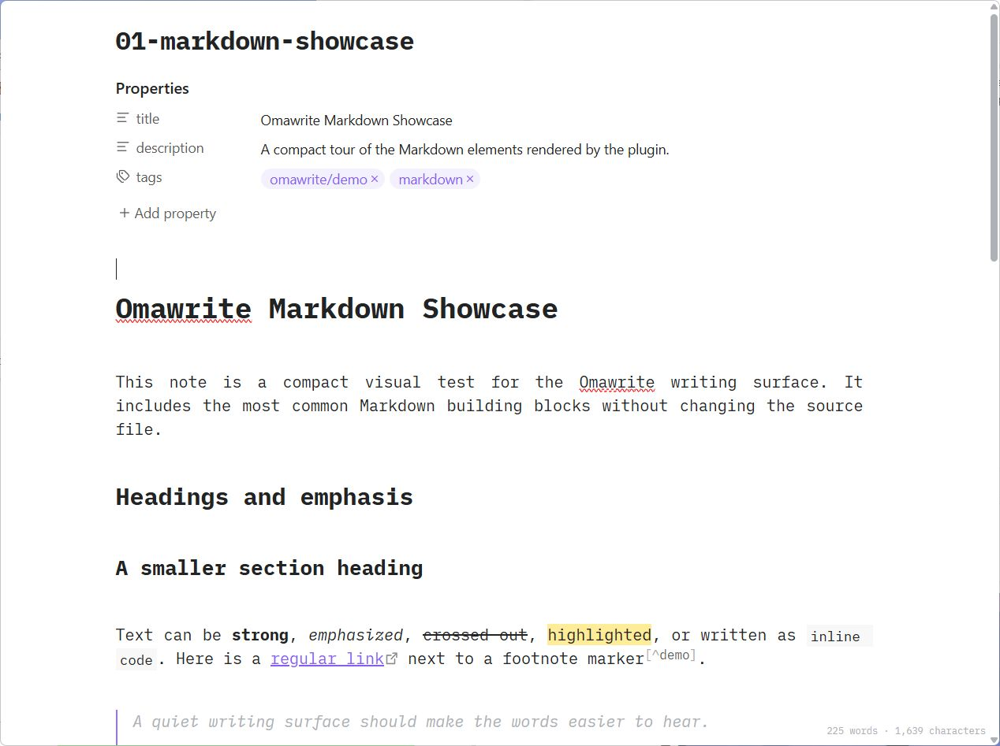
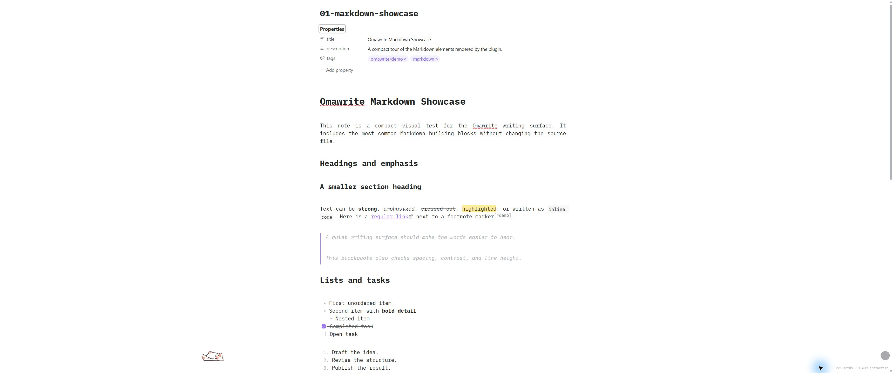
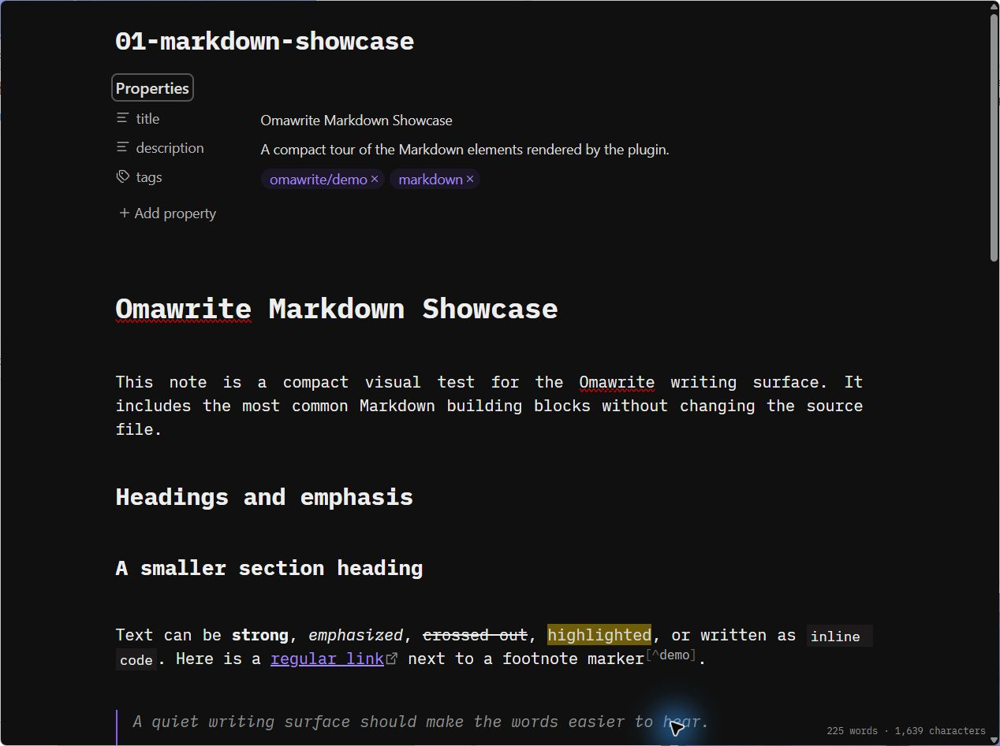
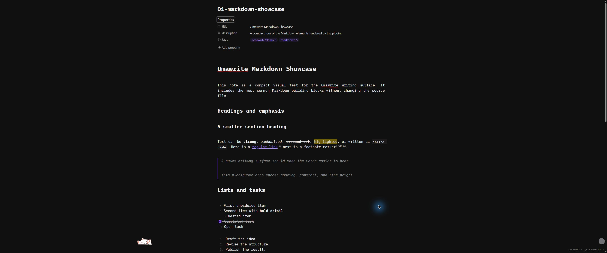
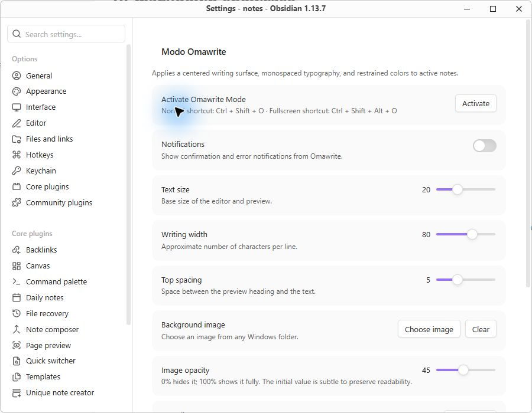
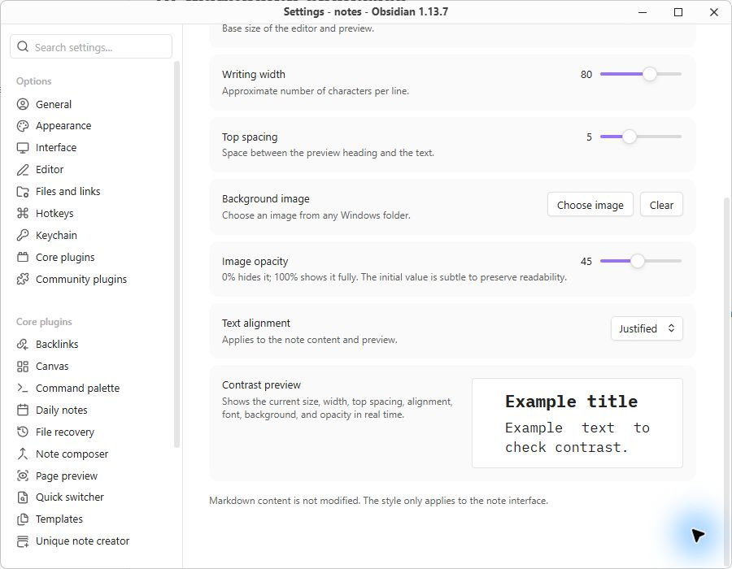

# Omawrite Mode for Obsidian

Omawrite Mode is a desktop-only Obsidian plugin by **neura-neura**. It brings the calm, focused writing surface of [Omawrite](https://github.com/omacom-io/omawrite) to the active Markdown note without changing the note's source.

It is a temporary viewing mode: activate it when you want to write, read, or review a note, then turn it off whenever you want. No frontmatter flag or other Omawrite marker is written to your vault.

## Highlights

- iA Writer Mono S typography with a clear heading hierarchy and a comfortable responsive writing column.
- Four text-alignment choices: left, justified, centered, and right.
- Optional background image from any Windows folder, with adjustable opacity.
- Live contrast preview in the settings panel using the same font, sizing, width, spacing, alignment, and background settings as the note view.
- Normal and native fullscreen writing modes, with corner controls that appear when the pointer approaches an edge.
- Live word and character counts, matching the understated Omawrite status indicator.
- Escape exits Omawrite; the fullscreen control only changes fullscreen state and preserves Omawrite mode.
- Optional confirmation and error notifications.
- English, Spanish, and Simplified Chinese translations, selected from Obsidian's interface language (other languages fall back to English).
- The plugin author is `neura-neura`.

## Screenshots

The screenshots use the bundled example notes and show both Obsidian themes, normal window mode, native fullscreen, and the complete settings surface.

### Light theme





### Dark theme





### Settings





## Installation

### Build from source

1. Clone or download this repository.
2. Run `npm install`.
3. Run `npm run build`.
4. Copy the repository folder into `<your-vault>/.obsidian/plugins/omawrite-mode/`.
5. In Obsidian, open **Settings → Community plugins**, enable community plugins if necessary, and enable **Omawrite Mode**.

The folder loaded by Obsidian must contain `manifest.json`, `main.js`, `styles.css`, and the `fonts/` directory.

## Usage

Open a Markdown note, then use the command **Toggle Omawrite mode for current note**. The default shortcuts are:

- `Mod+Shift+O` — toggle Omawrite Mode.
- `Mod+Shift+Alt+O` — toggle Omawrite Mode and native fullscreen together.

`Mod` means `Ctrl` on Windows/Linux and `Cmd` on macOS. Both commands are registered with Obsidian, so they can be reassigned in **Settings → Hotkeys**. The settings panel also displays the currently assigned shortcuts.

The **Activate Omawrite Mode** button in the plugin settings applies the normal or fullscreen variant according to Obsidian's current window state and closes Settings. If no note is open, it shows a notice instead. Press `Escape` or use the upper-right edge control to leave Omawrite. The lower-right edge control toggles native fullscreen only; leaving fullscreen returns to ordinary Omawrite mode.

## Settings

| Setting | What it controls |
| --- | --- |
| Text size | Base editor, reading view, and preview size. |
| Writing width | Approximate characters per line; the layout remains responsive across monitor sizes. |
| Top spacing | Space between the preview heading and the body text. |
| Background image | Choose a file through the Windows picker. The absolute path is persisted so images outside the vault can be reused. |
| Image opacity | Background visibility from hidden to fully visible. |
| Text alignment | Left, justified, centered, or right alignment for the note and preview. |
| Contrast preview | A compact, live sample of the current typography and background settings. |
| Notifications | Enable or disable Omawrite confirmation and error notices. |

The image is applied only while Omawrite is active. If the file is unavailable, the writing surface remains usable without a background image.

## Example notes

The [`examples/`](examples/) directory contains notes ready to copy into a vault:

- [`01-markdown-showcase.md`](examples/01-markdown-showcase.md) exercises headings, emphasis, links, footnotes, blockquotes, lists, tasks, code fences, tables, and separators.
- [`02-lorem-ipsum.md`](examples/02-lorem-ipsum.md) provides longer paragraphs for checking width, spacing, alignment, and the live counter.
- [`03-omawrite-options.md`](examples/03-omawrite-options.md) explains the settings and interaction controls while demonstrating additional Markdown.

## Development

```bash
npm install
npm run dev     # watch mode
npm run build   # production bundle
npx tsc --noEmit
```

The bundled iA Writer Mono S font is distributed under the [SIL Open Font License](fonts/OFL.txt). The plugin itself is authored by `neura-neura` and is intended for desktop Obsidian because the background-image picker uses the native Windows file dialog.
